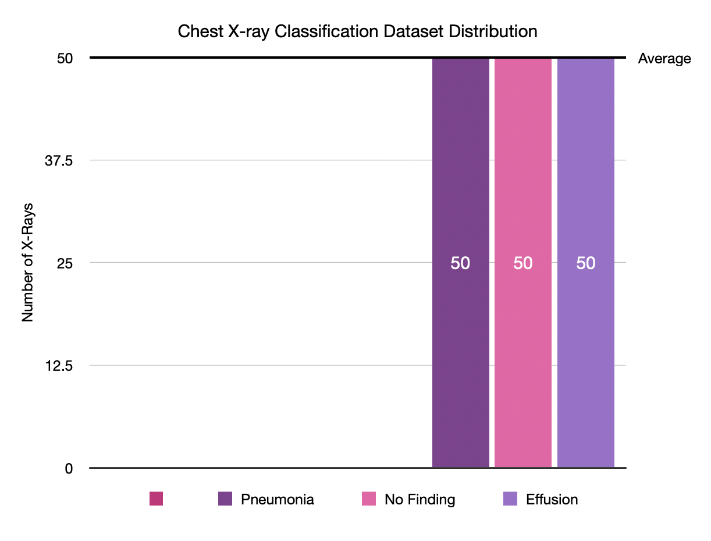

# Medical AI Chest X-ray Classification

## Overview
This project demonstrates a medical image annotation workflow for chest X-ray classification using Label Studio. A dataset of 150 chest X-ray images was organized into three classes:

- No Finding
- Pneumonia
- Effusion

Each image was manually annotated in Label Studio using the corresponding dataset label.

## Dataset Summary
- Total images: 150
- Class counts:
  - No Finding: 50
  - Pneumonia: 50
  - Effusion: 50
- Image directory: `images/`
- Label file: `master_labels.csv`

## Class Distribution



## Folder Structure
- `images/` — chest X-ray images used for classification
- `master_labels.csv` — consolidated label mapping for all image files
- `class_distribution.png` — chart visualizing the class balance across the dataset
- `project-9-at-2026-09-29-20-09-778e0c6d.csv` — exported annotation data from the labeling project
- `project-9-at-2026-09-29-20-09-778e0c6d.json` — exported annotation metadata in JSON format

## Label Format
The master label file contains two columns:

- `Image Index`
- `Finding Labels`

Example:

```csv
Image Index,Finding Labels
00000002_000.png,No Finding
00000005_000.png,No Finding
00000017_000.png,Pneumonia
00000022_000.png,Effusion
```


## Intended Use

This project is intended for educational and portfolio purposes, demonstrating a medical image classification annotation workflow. It can also serve as a starting point for future machine learning experiments using the annotated chest X-ray dataset.

## Notes
- The dataset is currently provided as a research-ready sample set rather than a full training pipeline.
- Annotation exports in the project folder reflect the labeling process used to generate the final labels.
- The images were selected from the NIH Chest X-ray14 dataset.

## Suggested Next Steps

1. Expand the dataset with additional chest X-ray images.
2. Perform bounding-box annotation for selected findings.
3. Explore image segmentation using medical imaging tools.
4. Prepare the annotated dataset for future machine learning experiments.
5. Evaluate annotation consistency and quality.

## Annotation Workflow

### 1. Dataset Preparation

- Selected 150 chest X-ray images from the NIH Chest X-ray14 dataset.
- Created a balanced sample with three classes:
  - No Finding: 50 images
  - Pneumonia: 50 images
  - Effusion: 50 images
- Organized the images and corresponding labels into a structured project dataset.

### 2. Label Studio Configuration

- Created a Label Studio project for chest X-ray image classification.
- Imported 150 chest X-ray images into the project.
- Configured three annotation choices:
  - No Finding
  - Pneumonia
  - Effusion
- Used image classification labels corresponding to the source dataset annotations.

### 3. Annotation Process

- Manually annotated all 150 chest X-ray images in Label Studio.
- Assigned one classification label to each image based on the corresponding source dataset label.
- Completed annotations across all three classes.
- Used the original dataset labels as ground truth rather than independently diagnosing the X-ray images.

### 4. Export and Quality Check

- Exported the completed annotations from Label Studio in CSV and JSON formats.
- Verified that all 150 images had corresponding annotations.
- Compared the annotation labels with the original `master_labels.csv` label mapping.
- Confirmed that the final dataset contained 50 images in each class.
## License and Usage
This README and dataset package are intended for educational and research use within the local project workspace. If you plan to publish or distribute the data externally, confirm the appropriate licensing and provenance requirements for the original medical image source.
